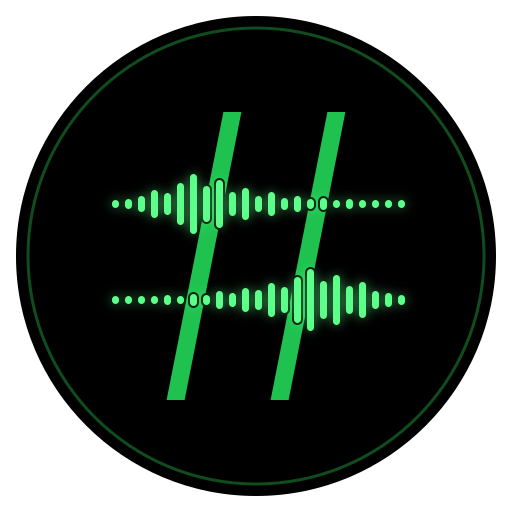

  
  <h1>RootedVox</h1>
  
<b>Rooted in community, echoing the truth. (扎根社区，自由发声)</b>

  
  <!-- 徽章区 -->
  

    
    
    
    
  

## 📖 项目简介
**RootedVox** 是一个独立的交流社区。我们致力于为大家提供一个自由、安全的交流平台。你可以在这里分享生活趣事、寻找志同道合的伙伴，或者发布互助信息。

## 🏗️ 架构设计 (Multi-Cloud Active-Active)
为了应对极其复杂的网络环境，并实现极致的性能与高可用性，本项目采用了**全栈多云双活架构**：

*   **前端托管**: 
    *   [Cloudflare Pages](https://github.com/RootedVox/cf-deploy) (主节点，利用边缘网络极速分发)
    *   [Vercel](https://github.com/RootedVox/vercel-deploy) (备用/并发节点)
*   **后端计算**:
    *   Cloudflare Workers (`functions/` 目录)
    *   Vercel Serverless Functions (`api/` 目录)
    *   *“异构同源”，一套逻辑双端运行。*
*   **数据与鉴权**: 
    *   **Supabase**: 核心数据库与对象存储 (严格配置 RLS 行级安全策略)。
    *   **Keycloak**: 自托管 OIDC 身份认证系统，保障数据隐私与高度可定制化。
*   **审核机制**: 词云本地库 + AI 大模型语义审核 + 人工后台复核（三层过滤）。

## 📂 核心仓库直达
本项目采用分离式部署策略，具体代码请前往对应仓库查看：

*   🚀 **[CF-Deploy](https://github.com/RootedVox/cf-deploy)** - 适配 Cloudflare 的前后端代码。
*   ▲ **[Vercel-Deploy](https://github.com/RootedVox/vercel-deploy)** - 适配 Vercel 的前后端代码。

## 🤝 参与贡献
我们欢迎任何形式的贡献！在提交 Pull Request 之前，请务必阅读我们的 [贡献指南 (CONTRIBUTING.md)](./CONTRIBUTING.md)。

## 🛡️ 开源协议
本项目采用 [Apache License 2.0](../LICENSE) 开源协议。
